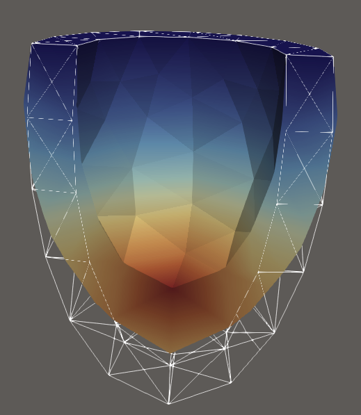
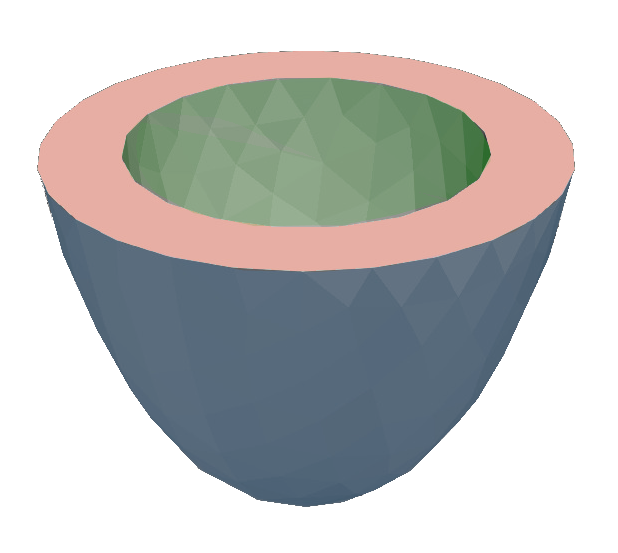
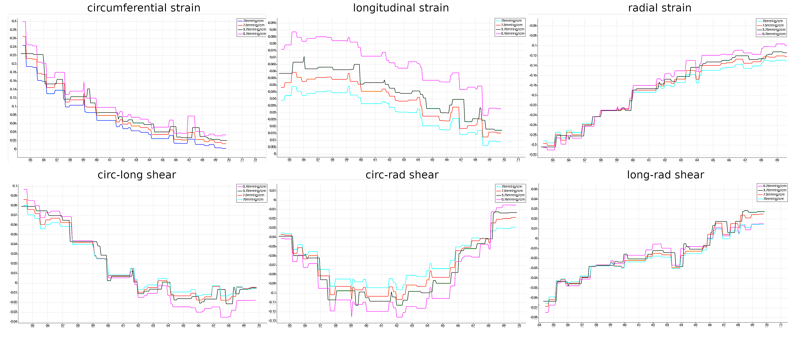
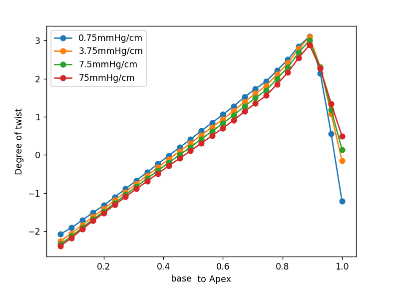
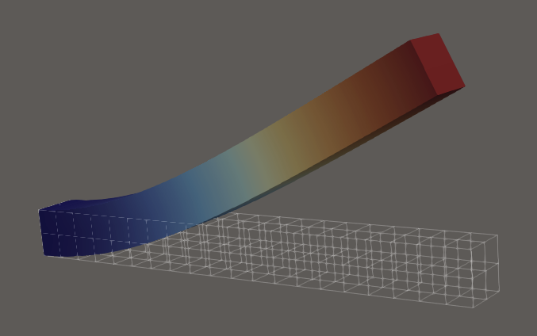
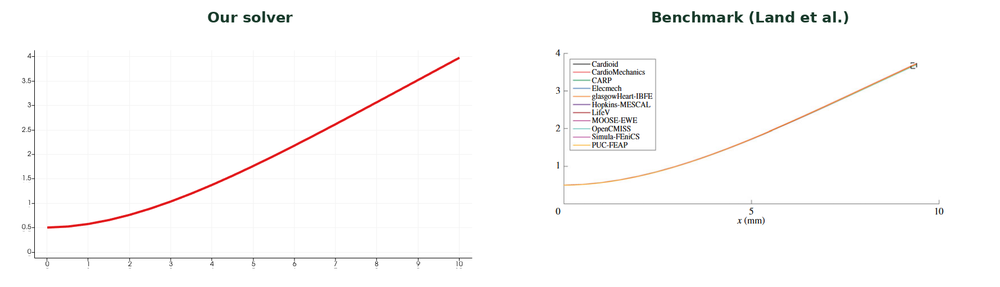
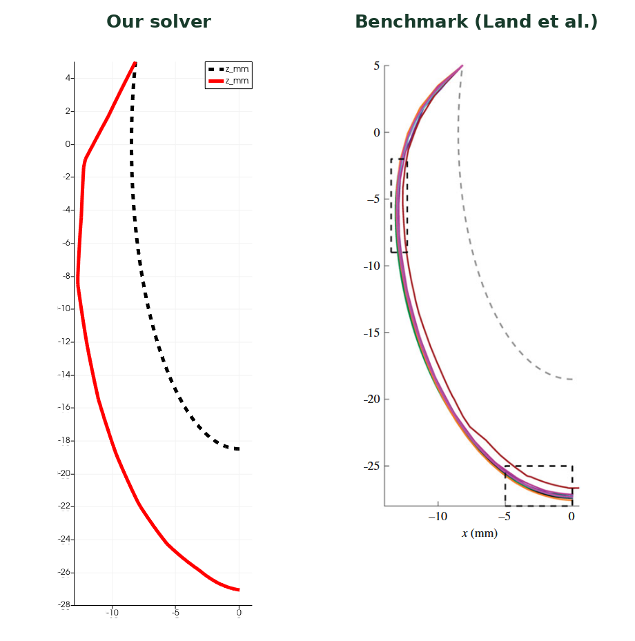
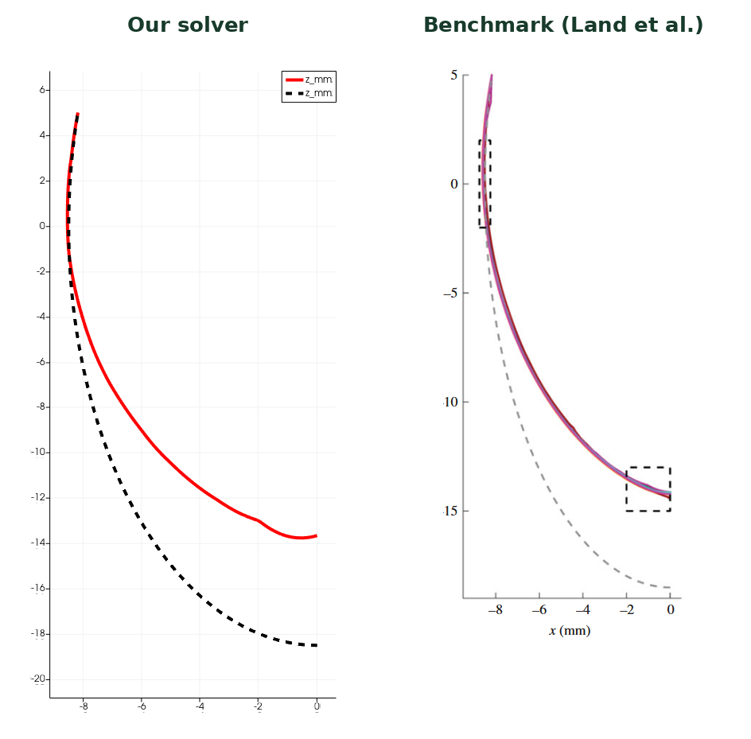
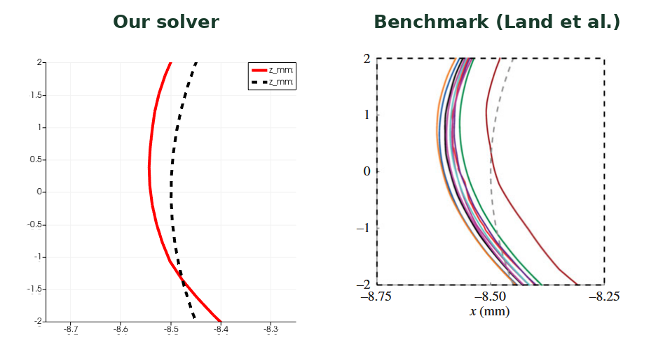

# Nonlinear Cardiac Mechanics

**A three-dimensional finite element solver for passive deformation and active contraction of an idealized left ventricle.**

This project investigates how ventricular geometry, myocardial fiber architecture, internal pressure, and external constraints influence cardiac deformation. It combines nonlinear continuum mechanics, anisotropic hyperelastic material models, and a Newton-Raphson solver, with benchmark comparisons and post-processing of ventricular volumes, strains, and rotation.

  

*Active contraction computed by our solver.*

**Authors:** Davide Mauri, Tommaso Roncaglio, Tommaso Viganò, Lorenzo Zani  
**Project presentation:** 25 February 2026

## Main features

- Three-dimensional finite element discretization with Gauss-Legendre quadrature.
- Anisotropic passive mechanics defined through a local fiber, sheet, and sheet-normal basis.
- Active contraction introduced through an additive active stress contribution.
- Pressure loading on the ventricular cavity and Robin conditions on the external surface.
- Newton-Raphson iterations, including Jacobian reuse between selected iterations.
- A Guccione constitutive-law implementation using automatic differentiation for benchmark evaluation.
- Post-processing of internal and external volumes, strain components, and ventricular rotation.

## Mechanical model

The displacement field $\mathbf{u}$ maps the reference configuration $\Omega_0$ into the deformed configuration. The deformation gradient and local volume ratio are

$$
\mathbf{F}=\mathbf{I}+\nabla_0\mathbf{u},
\qquad J=\det\mathbf{F},
\qquad \mathbf{C}=\mathbf{F}^{T}\mathbf{F}.
$$

Passive behavior is described by a strain-energy density with isotropic, anisotropic, and volumetric contributions:

$$
W=W_{\mathrm{iso}}+W_{\mathrm{a}}+W_{\mathrm{vol}},
\qquad
W_{\mathrm{vol}}(J)=\frac{K}{4}\left(J^2-1-2\ln J\right).
$$

The anisotropic terms depend on deformation along the local fiber and sheet directions. Active contraction adds a fiber-directed stress to the passive first Piola-Kirchhoff stress:

$$
\mathbf{P}=\frac{\partial W}{\partial\mathbf{F}}+\mathbf{P}_{\mathrm{a}},
\qquad
\mathbf{P}_{\mathrm{a}}=\Psi(I_{4,f})\,\mathbf{F}\mathbf{f}_0\otimes\mathbf{f}_0,
\qquad
I_{4,f}=\mathbf{f}_0\cdot\mathbf{C}\mathbf{f}_0.
$$

### Geometry and boundary conditions

The ventricular geometry is divided into three surfaces:

| Surface | Condition | Role |
| --- | --- | --- |
| Base | Prescribed normal displacement in the ventricular formulation | Constrains motion normal to the base |
| Internal wall | Pressure traction $\mathbf{P}\mathbf{N}_0=-p_vJ\mathbf{F}^{-T}\mathbf{N}_0$ | Models cavity pressure on the deformed surface |
| External wall | Robin condition $\mathbf{P}\mathbf{N}_0=-\alpha\mathbf{u}$ | Represents elastic support from surrounding tissue |

The ventricular benchmark tests use a fully fixed base, as specified by their test definitions.

  

*Base in pink, internal surface in green, and external surface in blue.*

## Numerical method

The equilibrium problem is formulated weakly on the reference configuration and discretized using the Galerkin finite element method. The residual combines contributions from the material stress, cavity pressure, and external Robin support.

At each Newton iteration, the displacement update is computed from

$$
\mathbf{J}_R(\mathbf{u}^{(k)})\,\delta\mathbf{u}^{(k)}
=\mathbf{R}(\mathbf{u}^{(k)}),
\qquad
\mathbf{u}^{(k+1)}=\mathbf{u}^{(k)}-\delta\mathbf{u}^{(k)},
$$

where $\mathbf{J}_R$ denotes the residual Jacobian, distinct from the deformation determinant $J$. Its assembly includes the material tangent and the derivatives of the boundary terms, including the deformation-dependent pressure load.

The solver supports selected iterations with a fixed Jacobian. A sparse Broyden update was also explored, but discarded because computing the approximation and maintaining its sparsity were too costly.

## Parameter tuning and ventricular mechanics

### External support

The Robin coefficient was tested at **0.75, 3.75, 7.5, and 75 mmHg/cm**, with an end-diastolic pressure of **1 kPa**. Comparing the predicted strain components with reference measurements led to the selection of **$\alpha=7.5$ mmHg/cm**.

*Comparison of normal and shear strain components used to tune the external support.*

### Rotation and twist

The post-processing routines evaluate rotation at selected ventricular slices to examine the variation from base to apex and its sensitivity to the external support coefficient.

  

The implemented routines include:

| Routine | Quantity |
| --- | --- |
| `compute_internal_volume()` | Ventricular cavity volume |
| `compute_external_volume()` | Volume enclosed by the external surface |
| `calculate_slice_rotation(double target_z, double tolerance)` | Rotation at a selected slice |
| `compute_strains()` | Strain quantities used to assess deformation |

## Benchmark evaluation

The Guccione model was used to evaluate the solver against the three cardiac mechanics benchmark problems of [Land et al. (2015)](https://doi.org/10.1098/rspa.2015.0641).

| Test | Setup | Material parameters | Loading |
| --- | --- | --- | --- |
| Beam deformation | $10\times1\times1$ mm beam; left face fixed; fibers along its length | $C=2$ kPa; $b_f=8$, $b_t=2$, $b_{fs}=4$ | Bottom-face pressure: $0.004$ kPa |
| Passive ventricular inflation | Idealized ventricle; base fixed | $C=10$ kPa; $b_f=b_t=b_{fs}=1$ | Internal pressure: $10$ kPa |
| Inflation and active contraction | Same ventricular geometry; base fixed; fiber angle from $-90^\circ$ at the epicardium to $+90^\circ$ at the endocardium | $C=2$ kPa; $b_f=8$, $b_t=2$, $b_{fs}=4$ | Internal pressure: $15$ kPa; active stress: $60$ kPa |

### 1. Beam deformation

This test examines the constitutive response and the implementation of pressure loading in a simple geometry.

  

### 2. Passive ventricular inflation

This test examines pressure-driven deformation of the ventricular geometry without active stress.

  

### 3. Inflation and active contraction

This test adds a spatially varying fiber architecture and active stress to the pressure-loaded ventricle. The deformed geometry is shown at the beginning of this README.

View the additional profile comparison

The comparisons reproduce the results presented in the project slides. They provide a visual assessment of the deformation profiles; quantitative error norms and mesh-convergence results are not reported in the presentation.

## References and figures

- Land, S. et al. (2015). *Verification of cardiac mechanics software: benchmark problems and solutions for testing active and passive material behaviour.* Proceedings of the Royal Society A, 471, 20150641. [DOI: 10.1098/rspa.2015.0641](https://doi.org/10.1098/rspa.2015.0641).
- Project presentation: *Non-linear Cardiac Mechanics*, 25 February 2026.

Figures were extracted from the project presentation. Panels labeled **Our solver** show the project's results; panels labeled **Benchmark (Land et al.)** reproduce the reference comparisons included in the slides. Paired plots have been arranged side by side for readability, preserving their original axes and legends.
